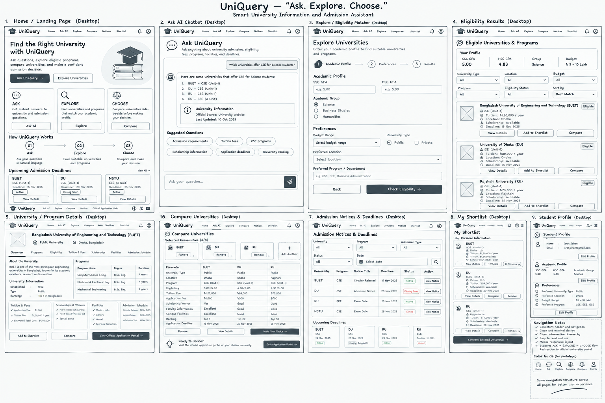

# UniQuery — “Ask. Explore. Choose.”

### A Smart University Information and Admission Assistant

[](https://software-project-design-development-cse-416-cliq5nmt1-keir2.vercel.app/)
[](https://react.dev/)
[](https://vite.dev/)
[](uniquery/src/__tests__)
[](https://oxc.rs/)

**Course:** Software Project Design and Development (CSE 416)
**Program:** B.Sc. in Computer Science and Engineering
**Department:** Computer Science and Engineering, University of Information Technology and Sciences (UITS)
**Academic Session:** Autumn 2026 · Batch 54th
**Course Instructor:** Dr. Mahfida Amjad Dipa, Senior Teacher

### Prepared By

| Student | ID | Role |
|---|---|---|
| **Israt Jahan** | 0432320005101130 | System Architect & Developer |
| **Md. Mehedi Hasan** | 0432320005101082 | Database Engineer & Project Documentarian |

---

## Table of Contents

1. [Project Overview](#1-project-overview)
2. [Live Demo and Repository](#2-live-demo-and-repository)
3. [Key Features](#3-key-features)
4. [Technology Stack](#4-technology-stack)
5. [Installation and Setup](#5-installation-and-setup)
6. [Project Structure](#6-project-structure)
7. [User Interface and Wireframe](#7-user-interface-and-wireframe)
8. [System Workflow](#8-system-workflow)
9. [System Design](#9-system-design)
10. [Testing and Quality Assurance](#10-testing-and-quality-assurance)
11. [Prototype Scope and Limitations](#11-prototype-scope-and-limitations)
12. [Data Accuracy Policy](#12-data-accuracy-policy)
13. [Project Documents](#13-project-documents)
14. [AI Tools and Academic Honesty](#14-ai-tools-and-academic-honesty)
15. [References](#15-references)

---

## 1. Project Overview

**UniQuery** is a smart university information and admission assistant for HSC applicants in Bangladesh. Applying to university is not a problem of *access* to information — the circulars are public — but of **interpretation**: every unit and cluster uses a different rule, eligibility depends on a combination of SSC and HSC grade points that students calculate by hand, fees and deadlines are buried in PDF circulars, and a wrong reading can cost a student an entire academic year.

UniQuery reduces that to a single three-stage workflow:

| Stage | What the student does | What the system does |
|---|---|---|
| **ASK** | Asks an admission question in plain language | Answers from a curated, verified knowledge base and **names the official source** of the answer |
| **EXPLORE** | Enters SSC GPA, HSC GPA and academic group | Evaluates **five admission tracks** and returns a verdict **with a written reason** for each |
| **CHOOSE** | Selects up to four universities | Renders a **side-by-side comparison matrix** with a difference highlight and a shortlist |

The design principle that runs through the whole product is simple: **no admission figure is displayed without a named, dated official source.**

---

## 2. Live Demo and Repository

| Item | Link |
|---|---|
| **Deployed product** | https://software-project-design-development-cse-416-cliq5nmt1-keir2.vercel.app/ |
| **Source repository** | https://github.com/Keya2323/Software-Project-Design-Development-CSE-416 |
| **Application folder** | [`uniquery/`](uniquery) |
| **Figma clickable prototype** | [Open prototype](https://www.figma.com/proto/vf6W3Yg0HSPzWweHDkVtlf/UniQuery?node-id=3-28092) |

> The application is a static build served over HTTPS from a CDN. It runs entirely in the browser — there is no backend, no account and no server-side storage.

---

## 3. Key Features

- **Conversational admission assistant (ASK)** — intent matching over a curated, source-cited knowledge base with an official circular attached to every answer.
- **Eligibility engine (EXPLORE)** — five admission tracks (BUET, DU Science Unit, MBBS, GST cluster, private universities) evaluated from three grade points, each returning a reasoned verdict.
- **Controlled comparison (CHOOSE)** — a criterion-by-criterion matrix capped at four universities, with the difference highlighted and the fourth slot left empty as a visible capacity indicator.
- **University and program directory** — 14 curated institution records with type, location, programs and verified source labels.
- **Admission notices and deadline tracker** — 9 official notices with a status that is **computed from today's date** (*active*, *closing soon*, *closed*), not a hand-written label.
- **Shortlist** — saved options that keep their deadline and eligibility badge, so a saved choice cannot silently go stale.
- **Student profile** — collects only the five values the eligibility rules actually consume; nothing is written to disk or transmitted.
- **Command palette** — keyboard search across universities, programs and circulars.
- **Responsive interface** — desktop, tablet and a 390 px mobile layout with a collapsed navigation drawer.
- **Accessibility** — every verdict carries its reason **in text**, not only in colour, so the answer survives a greyscale print and a screen reader.

---

## 4. Technology Stack

Versions are exactly as declared in [`uniquery/package.json`](uniquery/package.json).

| Concern | Technology | Version |
|---|---|---|
| UI library | React | `^19.2.8` |
| DOM rendering | React DOM | `^19.2.8` |
| Build tool and dev server | Vite | `^8.3.0` |
| React integration for Vite | `@vitejs/plugin-react` | `^6.1.1` |
| Icons | Lucide React | `^1.59.0` |
| Icons (CDN) | Bootstrap Icons 1.11.3, Font Awesome 6.5.1 | via `index.html` |
| Type and display font | Poppins | Google Fonts |
| Linting | Oxlint | `^1.81.0` |
| Testing | Vitest | `^4.1.0` |
| Component testing | React Testing Library + jest-dom + user-event | `^16.3.2` / `^6.9.1` / `^14.6.1` |
| Coverage | `@vitest/coverage-v8` | `^4.1.0` |
| DOM environment | jsdom | `^29.0.1` |
| Hosting | Vercel (static build, SPA rewrite) | — |

Bootstrap Icons, Font Awesome and Poppins are referenced from CDN/Google Fonts in `index.html`, so an internet connection is required for those assets to load. The icons are decorative; the interface remains usable without them.

---

## 5. Installation and Setup

### Prerequisites

- **Node.js 20 LTS** (or later) with npm 10
- Git, to clone the repository

### Run the project locally

```bash
# 1. clone the repository
git clone https://github.com/Keya2323/Software-Project-Design-Development-CSE-416.git
cd Software-Project-Design-Development-CSE-416/uniquery

# 2. install the exact dependency tree
npm install

# 3. start the development server
npm run dev
```

Open the local URL printed in the terminal (Vite defaults to `http://localhost:5173`).

### Production build and preview

```bash
npm run build      # generates the production bundle in dist/
npm run preview    # serves dist/ locally
```

### Available npm scripts

| Command | Purpose |
|---|---|
| `npm run dev` | Starts the Vite development server with hot module reload. |
| `npm run build` | Builds the production bundle into `dist/`. |
| `npm run preview` | Serves the production build locally. |
| `npm run lint` | Runs Oxlint over the source tree. |
| `npm test` | Runs the Vitest suite once (3 files, 9 test cases). |
| `npm run test:coverage` | Runs the suite and prints the v8 coverage report. |

### Key configuration files

| File | Purpose |
|---|---|
| `package.json` | Dependencies and npm scripts. |
| `package-lock.json` | Exact dependency versions used for installation. |
| `index.html` | Page title, metadata, font and icon links, and the React entry point (`/src/main.jsx`). |
| `vite.config.js` | React plugin, jsdom test environment, `setupTests.js`, and the v8 coverage provider with an explicit `include` list. |
| `.oxlintrc.json` | Oxlint rules, including the React rules of hooks. |
| `.gitignore` | Excludes `node_modules/`, `dist/` and other generated files from Git. |

---

## 6. Project Structure

```text
Software-Project-Design-Development-CSE-416/
├── README.md                     ← this document
├── UniQuery_Wireframe.png        ← the nine-screen desktop wireframe
├── Documents/
│   ├── Project Proposal of SPDD.pdf
│   ├── PROJECT REPORT of SPDD.pdf
│   ├── Diagram explanation of SPDD.pdf
│   └── Test_Report.pdf
└── uniquery/
    ├── index.html
    ├── package.json
    ├── vite.config.js
    ├── .oxlintrc.json
    ├── public/                   ← logo and favicon
    └── src/
        ├── App.jsx               ← shell, navigation and the single state owner
        ├── main.jsx
        ├── App.css, index.css
        ├── components/
        │   ├── HomeView.jsx
        │   ├── AskAiView.jsx
        │   ├── ExploreWizard.jsx
        │   ├── ExploreResults.jsx
        │   ├── EligibilityCalculatorModal.jsx
        │   ├── CompareView.jsx
        │   ├── UniversityDetailsView.jsx
        │   ├── NoticesView.jsx
        │   ├── ShortlistView.jsx
        │   ├── ProfileView.jsx
        │   ├── CommandPalette.jsx
        │   ├── QuickUniversityModal.jsx
        │   └── Header.jsx
        ├── data/
        │   ├── universities.js   ← 14 curated records + blank initialProfile
        │   ├── notices.js        ← 9 official notices with sources and deadlines
        │   └── chatKnowledge.js  ← the cited ASK knowledge base
        └── __tests__/
            ├── setupTests.js
            ├── test1_askAiKnowledge.test.js
            ├── test2_eligibilityCalculator.test.jsx
            └── test3_integrationFlows.test.jsx
```

---

## 7. User Interface and Wireframe

The interface was designed on a **nine-screen desktop wireframe** and prototyped in **Figma** before any component was written, so the wizard order and the comparison layout could be tested with two HSC graduates.



### The nine wireframe screens

1. **Home / Landing** — the promise, the three stages and the nearest deadlines.
2. **Ask AI** — the conversational assistant.
3. **Explore / Eligibility Matcher** — academic input and preferences.
4. **Eligibility Results** — the ranked, filterable result list.
5. **University / Program Details** — programs, eligibility, fees and schedule.
6. **Compare Universities** — the side-by-side matrix.
7. **Admission Notices & Deadlines** — the notice board with computed status.
8. **My Shortlist** — saved options with their deadlines.
9. **Student Profile** — the five values the rules consume.

| Screen | Delivered behaviour |
|---|---|
| **Home / Landing** | Introduces UniQuery with the tagline *“Ask. Explore. Choose.”*, offers **Ask UniQuery** and **Explore Universities**, and shows a live eligibility snapshot plus the nearest deadlines. |
| **Ask AI** | Conversational interface for admission, eligibility, fees, programs, facilities, scholarships and deadline questions; suggested questions for common queries; every answer carries a **source label** naming the official circular. |
| **Explore / Eligibility Matcher** | Collects SSC GPA, HSC GPA and academic group (Science / Business Studies / Humanities) plus preferences (budget, university type, location, preferred program); the **Check Eligibility** action drives the result set. |
| **Eligibility Results** | Shows the submitted profile, filters and sorts, and lists matching universities with tuition, location, scholarship and deadline; actions: **View Details**, **Add to Shortlist**, **Compare**. |
| **University / Program Details** | Overview, programs, eligibility, tuition and fees, scholarships, facilities and admission schedule; actions to shortlist, compare and open the official portal. |
| **Compare Universities** | Side-by-side matrix over university type, location, program, eligibility, tuition, application fee, scholarship or waiver, facilities, ranking and deadline; capped at four items with the guard enforced in the shell. |
| **Admission Notices & Deadlines** | Filters for university, program, admission type, status and date; status chips computed as **Active**, **Closing Soon** or **Closed**; a notice detail modal with the circular summary and the official link. |
| **My Shortlist** | Saved universities with program, tuition, scholarship, location and deadline; view, compare and remove actions, and a one-click comparison of the shortlisted set. |
| **Student Profile** | Name and email plus SSC/HSC GPA, academic group and preferences; **Edit Profile** actions; everything stays in session memory. |

Navigation is consistent across all screens: **Home · Explore · Admission Tools · Ask AI · Compare · Notices · Shortlist ⁄ Profile**, with a command palette on `⌘K` / `Ctrl+K`.

---

## 8. System Workflow

```text
HOME
 ├─ ASK      → question → cited answer → official circular
 ├─ EXPLORE  → academic profile → five-track eligibility verdict (with reasons)
 │              → eligibility results → university details
 ├─ CHOOSE   → comparison matrix (max 4) → shortlist
 ├─ NOTICES  → status computed from the deadline → notice detail → official portal
 └─ PROFILE  → the five values the rules consume (session only)
```

1. The student lands on **Home** and sees the three stages and the nearest deadlines.
2. **ASK** — the student asks a question; the knowledge engine returns the answer with the source and the verification date.
3. **EXPLORE** — the student enters SSC GPA, HSC GPA and group; the eligibility engine evaluates the five tracks.
4. Each track returns a verdict **and a written reason** — for example, which threshold was missed by how much.
5. The student reviews the **results** and opens a **university detail** view.
6. **CHOOSE** — up to four universities are compared criterion by criterion, and the difference is highlighted.
7. Selected options are saved in **My Shortlist**, carrying their deadlines and eligibility badges.
8. **Notices** shows the official circulars with a status computed from today's date.
9. The final act — the application itself — happens on the **official university portal**, which every notice links to.

---

## 9. System Design

The report documents the full model set, drawn before implementation:

| Model | What it settled |
|---|---|
| **Architecture (layered SPA)** | Four layers — presentation, state, domain and data — with dependencies pointing one way only. |
| **Use case** | The three-stage boundary and the service actors (official sources, content maintainer). |
| **ER model** | Six entities in third normal form, so the schema can move to PostgreSQL unchanged. |
| **Class model** | Which object owns the profile, shortlist and comparison set — the decision that later exposed two contract defects. |
| **Sequence diagrams (×2)** | The ASK round-trip, and the EXPLORE → CHOOSE path with the comparison guard. |
| **Activity diagram** | A student's decision path through the three stages. |

**Main components:** web interface (10 views + 3 modals) · ASK knowledge engine · eligibility engine · university data catalogue · comparison matrix · notice and deadline tracker · command palette.

**State ownership:** a single lifted state owner in `App.jsx` holds the profile, shortlist, comparison set and navigation; every child component is controlled and reports back through named callbacks. The eligibility and knowledge engines are **pure functions**, which is why they can be unit-tested without rendering a screen.

---

## 10. Testing and Quality Assurance

| Metric | Result |
|---|---|
| Test files | 3 |
| Test cases | 9 (Arrange–Act–Assert; equivalence partitioning and boundary-value analysis) |
| Final result | **9 / 9 passing** |
| Defects found by the suite | **4** — all fixed, all locked behind regression tests |
| Branch coverage (tested modules) | **70.87 %** |
| Statement coverage (knowledge engine) | **100 %** |
| Lint | **0 errors** (Oxlint) |
| Dependency audit | 0 vulnerabilities (`npm audit`) |

```bash
npm test               # 9/9
npm run test:coverage  # v8 coverage report
npm run lint           # 0 errors
```

The four defects the suite found — and the reason the failing run, not the passing one, is the most valuable artefact of the project:

| ID | Defect | Fix |
|---|---|---|
| **DEF-01** | `"du"` matched inside `"undergraduate"` in the knowledge engine | word-boundary expression `/\bdu\b/` plus a null guard |
| **DEF-02** | “Fully eligible” shown under an ineligible badge (Commerce group) | academic-group guard in the eligibility rules |
| **DEF-03** | Wizard callback not wired to the shell | prop contract named and wired, covered by a test |
| **DEF-04** | Notice status kebab-case mismatch | status normalised; `activeModalNoticeId` / `onOpenNotice` |

The suite was run against the **pre-fix baseline** (`89e3a50`, 5 passing / 4 failing) and again after the fixes (`75537ec`, 9/9), so the improvement is inspectable in the history rather than claimed.

---

## 11. Prototype Scope and Limitations

**In scope:** university information, admission assistance, eligibility matching, university and program discovery, university comparison, shortlisting, student profile management, and admission notices with deadline tracking — delivered as a responsive web application.

**Out of scope (stated honestly):**

- **Direct application submission.** UniQuery guides the student to the official portal; it does not submit the form.
- **Native mobile applications.** The interface is responsive and verified at a 390 px viewport, but there is no app-store build.
- **A complete national catalogue.** The directory holds **14 curated institutions and 9 official notices**; a national catalogue would be complete but could not be verified within the fourteen-week studio, so coverage was traded for a source label on every record.
- **Session persistence.** The profile, shortlist and comparison set live in memory only. Nothing is written to disk or sent to a server, because the users are minors and the privacy stance is a design requirement — so a reload starts a fresh session.
- **Open-ended natural language.** ASK answers from a curated, verified knowledge base with word-boundary intent matching. It is deterministic and testable, but it will not answer a question that is outside the catalogue; a retrieval-grounded model (RAG) is the recorded next step.
- **Automated CI.** The quality gates (lint, tests, coverage, build, smoke check) are executed manually before every merge and are fully specified as a GitHub Actions workflow in the report (§5.5); the workflow was not run by GitHub during this session.

---

## 12. Data Accuracy Policy

Every admission figure in the product follows one rule:

> **A number without an official source is not displayed.**

- Each university record and notice carries a `source` label naming the official publication and a verification date.
- Session-specific values — dates, eligibility, fees, seat counts, scholarships — are only stored when they can be confirmed in the current official circular.
- Statuses are **computed from today's date**, never hand-written, so the interface cannot claim “Active” for a deadline that has passed.
- The applicant profile fields ship as **blank defaults**; no personal data of any applicant is stored, transmitted or reproduced in the repository.
- **Always verify the final decision against the official circular of the university concerned.** UniQuery is a guide, not an authority.

Official sources used: [BUET](https://ugadmission.buet.ac.bd), [University of Dhaka](https://admission.eis.du.ac.bd), [DGME](https://dgme.gov.bd), [CKRUET](https://admission.ckruet.ac.bd), [GST cluster](https://gstadmission.ac.bd), [UGC Bangladesh](https://ugc.gov.bd).

---

## 13. Project Documents

All submitted documents are in the [`Documents/`](Documents) folder:

| Document | Contents |
|---|---|
| [`Project Proposal of SPDD.pdf`](Documents/Project%20Proposal%20of%20SPDD.pdf) | Problem, proposed solution, objectives, work breakdown structure, Gantt chart, budget and feasibility. |
| [`PROJECT REPORT of SPDD.pdf`](Documents/PROJECT%20REPORT%20of%20SPDD.pdf) | The full project report: requirements, design, implementation, testing, deployment, references, the appendices and the Assignment Justification Form. |
| [`Diagram explanation of SPDD.pdf`](Documents/Diagram%20explanation%20of%20SPDD.pdf) | Every system model with its explanation. |
| [`Test_Report.pdf`](Documents/Test_Report.pdf) | Test strategy, the nine test cases, the defect log, coverage and the gap analysis. |
| [`UniQuery_Wireframe.png`](UniQuery_Wireframe.png) | The nine-screen desktop wireframe. |

---

## 14. AI Tools and Academic Honesty

The course sets a specific order: **the artefact is designed and produced by the team first, and an assistant tool is used afterwards** to refine, explore or verify it. That order was followed and is recorded interaction by interaction in the report (Section 4.5 and Appendix A).

| Tool | How it was used |
|---|---|
| **Figma** | Clickable prototype of the nine screens, produced before any component existed — the interface contract. |
| **Visual Studio Code** | The only code editor used: editing, debugging, integrated terminal and the Git panel. |
| **Google Docs** | Shared drafting of the proposal, the SRS and the report, with comment threads and version history. |
| **ChatGPT (OpenAI)** | Review assistant for requirement wording, test edge cases and error explanation. |
| **Claude (Anthropic)** | Review assistant for model consistency and answer wording. |
| **Gemini (Google)** | Independent second check on eligibility thresholds and DOM query style. |
| **Arena.ai Agent Mode** | Copy-editing and consistency assistant for the report: cross-reference and page-budget checking. |

Every output was reviewed and adapted by the two project members, who are responsible for the final implementation and content. **No assistant tool wrote the system models, the test assertions or the source of the application**; those are the team's own work. Two tool suggestions were explicitly **rejected** and the reasons are recorded (a word allow-list for DEF-01, and a rounding rule for the thresholds).

---

## 15. References

### 15.1 Technologies and libraries

1. **React 19 documentation** — https://react.dev/
2. **Vite 8 guide** — https://vite.dev/guide/
3. **Vitest documentation and coverage guide** — https://vitest.dev/
4. **React Testing Library and jest-dom** — https://testing-library.com/
5. **Lucide React — icon library** — https://lucide.dev/guide/packages/lucide-react
6. **Oxlint — JavaScript and TypeScript linter** — https://oxc.rs/docs/guide/usage/linter
7. **Git and GitHub Actions documentation** — https://docs.github.com/
8. **Vercel — deploy a Vite application** — https://vercel.com/docs

### 15.2 UI resources

9. **Google Fonts — Poppins** — https://fonts.google.com/specimen/Poppins
10. **Bootstrap Icons** — https://icons.getbootstrap.com/
11. **Font Awesome** — https://fontawesome.com/

### 15.3 Design

12. **UniQuery — Figma clickable prototype** — https://www.figma.com/proto/vf6W3Yg0HSPzWweHDkVtlf/UniQuery?node-id=3-28092

### 15.4 Official admission sources

13. **BUET — Undergraduate Admission Circular 2026/2027** — https://ugadmission.buet.ac.bd
14. **University of Dhaka — Science Unit (KA) Admission Circular 2026** — https://admission.eis.du.ac.bd
15. **DGME — National MBBS Admission Test Circular 2026** — https://dgme.gov.bd
16. **CKRUET — Combined Engineering Admission Circular 2026** — https://admission.ckruet.ac.bd
17. **GST Central Committee — Public University Admission Circular 2026** — https://gstadmission.ac.bd
18. **University Grants Commission of Bangladesh** — https://ugc.gov.bd

### 15.5 AI tools and assistance

19. **ChatGPT — OpenAI** — https://chatgpt.com/
20. **Claude — Anthropic** — https://claude.ai/
21. **Gemini — Google** — https://gemini.google.com/
22. **Arena.ai Agent Mode** — https://arena.ai

> University admission requirements, tuition fees, scholarships, program details and admission deadlines change every cycle. Always verify them on the respective university's official website before acting on them.

---

<p align="center">
<b>UniQuery — “Ask. Explore. Choose.”</b><br>
CSE 416 · Software Project Design and Development · Autumn 2026<br>
Department of CSE, University of Information Technology and Sciences (UITS)
</p>
