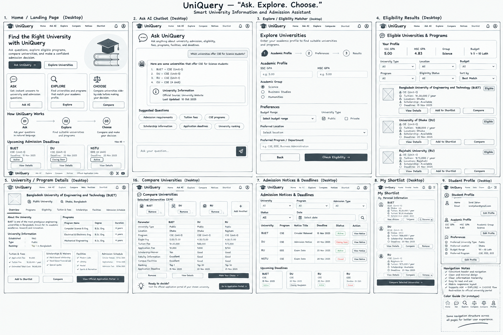

# UniQuery — “Ask. Explore. Choose.”

### A Smart University Information and Admission Assistant

**Course:** Software Project Design & Development (CSE 416)  
**Academic Session:** Autumn 2026  
**Supervisor:** Dr. Mahfida Amjad Dipa, Senior Teacher, Department of CSE

### Prepared By
- **Israt Jahan**
- **Md. Mehedi Hasan**

---

## 1. Project Overview

**UniQuery** is a smart university information and admission assistant designed to help admission-seeking students search, evaluate, and compare university options using their academic profile, preferences, and available university information.

The system follows the three-stage workflow:

**ASK → EXPLORE → CHOOSE**

- **ASK:** Conversational AI assistance for admission-related questions.
- **EXPLORE:** Eligibility matching and university/program discovery.
- **CHOOSE:** Side-by-side comparison of shortlisted universities.

---

## 2. Key System Features

- Conversational AI Chatbot
- Smart Eligibility Matcher
- University and Program Information
- Side-by-Side University Comparison
- Admission Notices and Deadline Tracker
- Tuition Fee and Scholarship Information
- Student Profile and Shortlist Management
- Responsive Web User Interface

## 3. Technology Stack

The current project configuration uses the following technologies and tools:

- **Frontend library:** React (`^19.2.8`)
- **DOM rendering:** React DOM (`^19.2.8`)
- **Development server and build tool:** Vite (`^8.3.0`)
- **React integration for Vite:** `@vitejs/plugin-react` (`^6.1.1`)
- **Icons:** Lucide React (`^1.59.0`), Bootstrap Icons, and Font Awesome
- **Font:** Poppins, loaded from Google Fonts
- **Code linting:** Oxlint (`^1.81.0`)

Bootstrap Icons, Font Awesome, and Poppins are referenced in `index.html` through external CDN/Google Fonts links, so an internet connection may be needed for those assets to load.

### Installation and Setup

#### Prerequisites

- Node.js and npm installed on your computer
- The UniQuery project files downloaded or cloned to your computer

#### Run the Project Locally

1. Open a terminal in the project root folder (the folder containing `package.json`).
2. Install the dependencies:

   ```bash
   npm install
   ```

3. Start the Vite development server:

   ```bash
   npm run dev
   ```

4. Open the local URL shown in the terminal in your web browser.

#### Create and Preview a Production Build

Build the project:

```bash
npm run build
```

Vite generates the production build in the `dist/` directory. To preview that build locally, run:

```bash
npm run preview
```

#### Available npm Commands

| Command | Purpose |
|---|---|
| `npm run dev` | Starts the local development server. |
| `npm run build` | Builds the application for production. |
| `npm run lint` | Runs Oxlint to check the code. |
| `npm run preview` | Previews the production build locally. |

### Main Configuration Files

- **`package.json`** — Lists project dependencies and available npm scripts.
- **`package-lock.json`** — Records the dependency versions used for installation.
- **`index.html`** — Provides the page title, metadata, font and icon links, and the React entry point (`/src/main.jsx`).
- **`vite.config.js`** — Configures Vite with the React plugin.
- **`.oxlintrc.json`** — Configures Oxlint rules, including React rules of hooks.
- **`.gitignore`** — Excludes generated files and local-only files such as `node_modules/` and `dist/` from Git.

---

## 4. User Interface & Wireframe

The UniQuery wireframe presents the main desktop interface and follows the **ASK → EXPLORE → CHOOSE** workflow.

### UniQuery Wireframe



The wireframe contains the following **9 major screens**:

1. **Home / Landing Page**
2. **Ask AI Chatbot**
3. **Explore / Eligibility Matcher**
4. **Eligibility Results**
5. **University / Program Details**
6. **Compare Universities**
7. **Admission Notices & Deadlines**
8. **My Shortlist**
9. **Student Profile**

### 4.1 Home / Landing Page
- Introduces UniQuery with the tagline **“Ask. Explore. Choose.”**
- Provides primary actions for **Ask UniQuery** and **Explore Universities**.
- Presents the three main functions: ASK, EXPLORE, and CHOOSE.
- Shows how UniQuery works through the three-step workflow.
- Provides quick access to upcoming admission deadlines.

### 4.2 Ask AI Chatbot
- Provides a conversational interface for admission-related questions.
- Allows students to ask about admission, eligibility, fees, programs, facilities, scholarships, and deadlines.
- Includes suggested questions for common admission queries.
- Provides university information with source/update information.

### 4.3 Explore / Eligibility Matcher
- Collects academic information such as SSC GPA, HSC GPA, and academic group.
- Supports academic groups including Science, Business Studies, and Humanities.
- Includes preferences such as budget range, university type, location, and preferred program.
- Provides a **Check Eligibility** action to generate matching results.

### 4.4 Eligibility Results
- Displays the student's submitted profile.
- Provides filtering and sorting options.
- Lists suitable universities/programs with information such as tuition, location, scholarship availability, and deadlines.
- Provides actions such as **View Details**, **Add to Shortlist**, and **Compare**.

### 4.5 University / Program Details
- Presents detailed information about a selected university/program.
- Includes overview, programs, eligibility, tuition and fees, scholarships, facilities, and admission schedule.
- Provides actions to add to shortlist, compare, and access the official application portal.

### 4.6 Compare Universities
- Allows students to select multiple universities for comparison.
- Presents selected universities in a side-by-side comparison layout.
- Compares important information such as university type, location, program, eligibility, tuition fee, application fee, scholarship/waiver, facilities, ranking, and application deadline.
- Provides options to continue toward the student's choice and official application portal.

### 4.7 Admission Notices & Deadlines
- Provides filters for university, program, admission type, status, and date.
- Displays notices with deadlines, status, and view-notice actions.
- Includes an upcoming-deadlines section.
- Uses status indicators such as **Active**, **Closing Soon**, and **Closed**.

### 4.8 My Shortlist
- Stores universities selected by the student.
- Displays important information including program, tuition, scholarship, location, and deadline.
- Provides actions to view details, compare, and remove universities.
- Provides an option to compare shortlisted universities.

### 4.9 Student Profile
- Displays student information such as name and email.
- Shows academic information including SSC GPA, HSC GPA, and academic group.
- Shows preferences such as university type, location, budget range, and preferred program.
- Provides **Edit Profile** actions.
- Supports the personalized admission-assistance workflow.

---

## 5. Wireframe Design & Navigation

The wireframe uses a consistent navigation structure across the main desktop screens.

### Main Navigation
- Home
- Ask AI
- Explore
- Compare
- Notices
- Shortlist
- Profile

### Main User Journey

**HOME → ASK / EXPLORE → ELIGIBILITY RESULTS → UNIVERSITY DETAILS → COMPARE / SHORTLIST → NOTICES → OFFICIAL APPLICATION PORTAL**

The wireframe emphasizes:
- Clear information hierarchy
- Consistent navigation
- Simple and readable layouts
- Easy comparison of university options
- Quick access to deadlines and notices
- User-friendly admission assistance

---

## 6. Figma UI / Clickable Prototype

The Figma prototype is based on the submitted UniQuery wireframe and demonstrates the connected user flow between the major screens.

### Figma Prototype

[Open UniQuery Figma Prototype](https://www.figma.com/proto/vf6W3Yg0HSPzWweHDkVtlf/UniQuery?node-id=3-28092&t=ae6rSV8ojlV7ngHp-1)

---

## 7. System Workflow

1. The student accesses UniQuery through the Home page.
2. **ASK:** The student asks admission-related questions through the AI chatbot.
3. **EXPLORE:** The student enters academic information and preferences.
4. The eligibility matcher identifies suitable universities and programs.
5. The student reviews eligibility results and university details.
6. **CHOOSE:** The student compares suitable universities side-by-side.
7. The student can save selected options in **My Shortlist**.
8. The student checks admission notices and deadlines.
9. The student can proceed to the official application portal.

---

## 8. System Design

The project includes the following system models:
- Component Diagram
- Activity Diagram
- Sequence Diagram
- Fishbone Diagram

The main system components include:
- Web Interface
- AI Chatbot
- University Information Database
- Eligibility Matcher
- Comparison Dashboard
- Notice & Deadline Tracker

---

## 9. Prototype Scope

The prototype is a responsive web platform focused on:
- University information
- Admission assistance
- Eligibility matching
- University/program discovery
- University comparison
- Shortlisting
- Student profile management
- Admission notices and deadline tracking

Direct university application submission and native mobile applications are outside the current prototype scope.

---

## 10. Submitted Materials

### Wireframe
The complete UniQuery desktop wireframe is included in this repository as:

`UniQuery_Wireframe.png`

### Figma Prototype
[Open UniQuery Figma Prototype](https://www.figma.com/proto/vf6W3Yg0HSPzWweHDkVtlf/UniQuery?node-id=3-28092&t=ae6rSV8ojlV7ngHp-1)

---


---

## 11. References

### 11.1 Technologies and Libraries

1. **React Documentation**  
   https://react.dev/

2. **Vite Documentation**  
   https://vite.dev/guide/

3. **Lucide React — Icon Library**  
   https://lucide.dev/guide/packages/lucide-react

4. **Oxlint — JavaScript and TypeScript Linter**  
   https://oxc.rs/docs/guide/usage/linter.html

### 11.2 UI Resources

5. **Google Fonts — Poppins**  
   https://fonts.google.com/specimen/Poppins

6. **Bootstrap Icons**  
   https://icons.getbootstrap.com/

7. **Font Awesome Icons**  
   https://fontawesome.com/

### 11.3 Project Design

8. **UniQuery — Figma Prototype**  
   https://www.figma.com/proto/vf6W3Yg0HSPzWweHDkVtlf/UniQuery?node-id=3-28092&t=ae6rSV8ojlV7ngHp-1

### 11.4 AI Tools and Assistance

9. **ChatGPT — OpenAI**  
   https://chatgpt.com/

10. **Gemini — Google**  
    https://gemini.google.com/

11. **Claude — Anthropic**  
    https://claude.ai/

AI tools were used as development-support resources for tasks
such as brainstorming, understanding technical concepts,
improving documentation, and obtaining coding assistance,
where applicable. The outputs were reviewed and adapted by
the project members, who are responsible for the final
implementation and content.

### 11.5 University Information Sources

University admission requirements, tuition fees, scholarships,
program details, and admission deadlines should be verified
using the respective universities' official websites.

---
